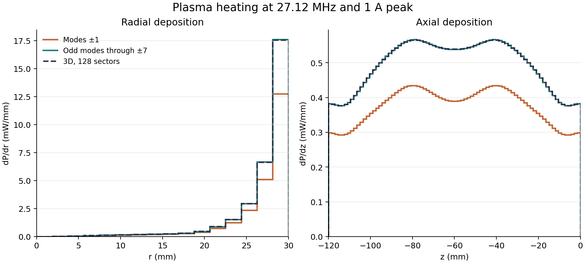

# Prescribed-current Nagoya RF benchmark

This optional case compares two discretizations of the same driven electromagnetic
problem. It uses the frequency, chamber, dielectric, antenna dimensions and uniform
plasma parameters from `config/rf_nagoya.json`. Both solvers put uniform cold plasma
inside the dielectric tube and vacuum outside it. Both end plates and the enclosing
cylinder are perfect electrical conductors (PEC). The benchmark sets its own
outer radius, mesh and current. The production configuration's vacuum-case selector,
gap voltage, PML and solver settings belong to a different experiment.

The defaults give a plasma radius of 30 mm, a chamber length of 120 mm, a 3 mm
dielectric wall, an antenna sheet at 39 mm and a PEC enclosure at 60 mm. The drive
is 27.12 MHz with 1 A peak through the forward rail. The uniform axial field is
14 mT, the electron density is 2.643 × 10¹⁸ m⁻³ and the collision rate is
2.0 × 10⁷ s⁻¹. Results describe that prescribed antenna current. Predicting
the current from a generator voltage requires a feed and loading model.

## Source and solvers

On the antenna sheet of radius a, the surface current components are
Kz = I g′(φ) w(z)/a and Kφ = −I g(φ) w′(z). The derivative g′ is a pair of
opposite top hats with integrals +1 and −1 centred at 0 and π. Each spans the
configured rail width (0.16 rad). The periodic function g is its zero-mean
primitive. The envelope w increases linearly from zero to one over the first
6 mm end ring, stays at one along the rails and falls to zero across the other
ring. Together these components have zero surface divergence, including the
rail-to-ring transitions. Each return splits between the two sides of the ring.

The meridional solver projects this source analytically. Its half-turn
antisymmetry excites odd azimuthal modes. Positive and negative m are solved
separately using peak phasors with exp(imφ − iωt). Each mode uses its absolute
Fourier coefficient for the specified rail current. Summing their dissipated
watts gives the azimuthally integrated heating.

The 3D reference uses an independently assembled polygonal disk extruded into
prisms. The load is integrated in real space, splitting panels at rail and ring
edges. An exact discrete sine/cosine transform in z splits the prism matrix
into smaller solves. It retains all discrete axial harmonics and all angular
edge unknowns. This factorization relies on a uniform axial mesh, axial magnetic
field, and material coefficients independent of z. A small regression compares
its source work and volume loss against the assembled monolithic prism matrix.
The [uniform-cylinder benchmark](rf-modes.md) supplies the analytic dispersion test.

## Reproduce the comparison

Run from the repository root with NumPy and SciPy. Set the BLAS limits before
starting Python to compare serial timings. Each solve takes a fresh directory.

```sh
export OPENBLAS_NUM_THREADS=1 OMP_NUM_THREADS=1 VECLIB_MAXIMUM_THREADS=1
python3 -m helicon.rf_modes.nagoya --out runs/nagoya-01
python3 -m helicon.rf_modes.nagoya --modal-only --max-m 7 --out runs/nagoya-m7
python3 -m helicon.rf_modes.nagoya --modal-only --radial-cells 32 4 8 16 --nz 160 --out runs/nagoya-fine
python3 -m helicon.rf_modes.slices --run runs/nagoya-01 --phi-deg 0 90 --out runs/nagoya-slices
python3 -m helicon.rf_modes.nagoya_plot --run runs/nagoya-01 --out runs/nagoya-profiles.png
```

### Import the material used by a 3D RF solve

Pass `--material-from-rf SOLUTION --modal-only` to use the inputs of a
completed 3D plasma RF solution. The source and modal runs must have matching
plasma chamber dimensions, origin and frequency. The importer verifies the
saved RF configuration and input hashes, samples the finite-volume density and
collision frequency and interpolates the axisymmetric magnetic field at each
modal plasma cell center. A uniform input recorded by the 3D solver comes from
its own `rf.json`. A spatially uniform Cartesian magnetic field must be axial.
The current sheet, dielectric wall, exterior and PEC boundaries follow the
Nagoya configuration. The axially transformed prism reference requires its
original coefficient assumptions, so the mapped option uses the modal solver.

The command below uses the grid, enclosure, excitation and RF configuration
from a previous Nagoya run. Set the three input paths to the corresponding
run directories on the machine that holds the 3D results. Run from the project
root in Bash.

```bash
(
set -e
export OPENBLAS_NUM_THREADS=1 OMP_NUM_THREADS=1 VECLIB_MAXIMUM_THREADS=1
out=$(mktemp -d runs/nagoya-mapped-XXXXXX)
echo "Saving in $out"
python3 -u - "$out" <<'PY'
import json
import subprocess
import sys
from pathlib import Path

out = Path(sys.argv[1])
baseline = Path("runs/nagoya-r128-z160-m9")
sources = {
    "uniform": Path("runs/rf-pml45-uniform-nagoya-0XISqn/cold-r300-tRAG7y/solution"),
    "feedback": Path("runs/rf-feedback-cycle2-pml-interface45mm-20261123-085905/solution"),
}
record = json.loads((baseline / "run.json").read_text())
config = out / "nagoya.json"
config.write_text(json.dumps(record["rf_inputs"], indent=2))
for name, source in sources.items():
    subprocess.run([
        sys.executable, "-m", "helicon.rf_modes.nagoya",
        "--config", str(config), "--out", str(out / name),
        "--material-from-rf", str(source), "--modal-only", "--max-m", "11",
        "--radial-cells", *map(str, record["radial_cells"]), "--nz", str(record["nz"]),
        "--outer-radius", str(record["outer_radius_m"]), "--current", str(record["current_peak_A"]),
    ], check=True)
    result = json.loads((out / name / "run.json").read_text())
    m9 = next(row for row in result["sweep"] if row["max_abs_m"] == 9)
    print(name, "cutoff 9 vs 11:", m9["vs_last_cutoff"], flush=True)
PY
)
```

Mapped runs save `material_rz.npz` with `epsilon_r_cyl[iz,ir,3,3]` and
physical radial and axial faces for the **whole** modal mesh. The tensor basis
is `(r,phi,z)`. Slice reconstruction reads and verifies this artifact, so
the source RF directory can be archived elsewhere. As in uniform runs,
`heating_rz.npz` contains plasma-cell watts and volumes at the largest cutoff.
Smaller-cutoff maps can be obtained by summing the corresponding signed
`mode_*.npz` cell watts over the plasma columns. Compare source work and losses
at the prescribed current for each mode. For a voltage-driven 3D comparison,
normalize the plasma-cell watts to the same absorbed power and compare on common
physical bins. With non-nesting axial grids (e.g. 160 to 64), distribute each
cell's watts by axial overlap and annular area overlap.

Plotting needs Matplotlib. The four radial counts refer to plasma, dielectric
wall, vacuum between wall and sheet, and vacuum between sheet and enclosure.
Use `--sectors` to set the 3D angular mesh and `--current` to set peak amperes.

| Output | Contents |
|---|---|
| `run.json` | Inputs, per-mode and 3D work, loss, residuals, timing, cutoff comparison and angular refinement. `completed` requires source-work closure, a free-DOF residual below 10⁻⁷ and the cell passivity check in every solve. |
| `mode_±m.npz` | Complex cylindrical electric-field DOFs, cell-centre E and B peak phasors, mesh edges and quadrature-integrated watts per cell in every material. |
| `heating_rz.npz` | Plasma-only azimuthally averaged heating in W/m³, cell watts, annular volumes and grid faces, indexed by (z,r). |
| `radial_profiles.csv`, `axial_profiles.csv` | Watts per bin for every modal cutoff and each 3D angular mesh. Each column sums to its plasma absorption. Divide by bin width for power per unit length. |
| `reference_N.npz` | 3D cell losses summed over each polygonal ring and axial interval, including all materials. |
| `slice_*.npz` | Reconstructed cell-centre E, B and local heating at each requested angle. The fields are summed before evaluating heating, retaining interference between modes. |

The shape errors compare each profile after division by its own total plasma
power. The reported L1 distance is the sum of absolute differences in bin
fractions. The separate power error compares absolute watts. Timing includes
assembly, solve and loss integration and excludes writing the field files.

## Measured comparison

On the default 16/2/4/8 radial mesh with 80 axial intervals, the eight signed
modes through |m| = 7 gave 59.238 mW. The 128-sector prism solve gave
59.210 mW. The normalized radial and axial profile distances were 0.313% and
0.098%. Increasing the angular mesh from 64 to 128 sectors changed total power
by 0.208%. At 128 sectors a rail spans 3.26 panels. These integrated comparisons
leave pointwise fields at the rail edges unverified.



The modal cutoff of 15 gave 54.700, 59.357 and 58.071 mW on successive meshes
with 8/40, 16/80 and 32/160 plasma-radial/axial cells. All radial layers were
refined together. The nonmonotonic sequence leaves the mesh-converged power
uncertain. The final refinement changed power by 2.17%, while extending the
cutoff from 7 to 15 changed it by about 0.21% on the finest mesh. The cutoff of
7 is a reasonable starting point for integrated heating with these inputs.
Different magnetic fields, plasma profiles or antenna currents require a fresh
cutoff check.
